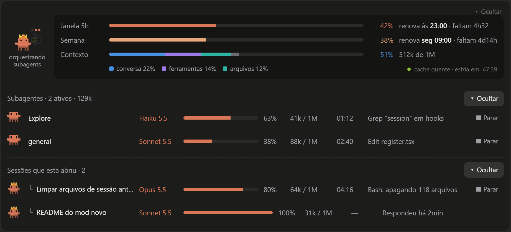

<picture>
  <source media="(prefers-color-scheme: dark)" srcset="assets/hero-grafite.svg">
  
</picture>

<h1 align="center">Clawd-Usage-HUD</h1>

<p align="center">Mod do Claude Code que mostra, numa faixa acima do prompt, quanto da janela de 5 horas, da semana e do contexto a sessão já usou, junto com os subagentes e as sessões que ela abriu.</p>

<p align="center">
  
  
  <a href="LICENSE"></a>
</p>

<p align="center">
  <a href="#começar-a-usar">Começar a usar</a> &nbsp; / &nbsp;
  <a href="#demonstração-e-recursos">Ver recursos</a> &nbsp; / &nbsp;
  <a href="#documentação-e-ajuda">Documentação</a>
</p>

---

## Sobre o projeto

Quem trabalha o dia todo com o Claude Code descobre o limite de uso tarde demais: a janela de 5 horas acaba no meio de uma tarefa, o contexto enche sem aviso e o cache esfria enquanto você está fora. O Clawd-Usage-HUD coloca esses números à vista, acima da caixa de mensagem, sem abrir outra tela.

Um personagem, o Rei Clawd, mostra o que a sessão está fazendo (lendo, editando, no terminal, orquestrando subagentes e outras 10 poses). Ao lado dele ficam três barras: janela de 5 horas, limite semanal e contexto. Abaixo, os subagentes em andamento e as sessões que esta sessão abriu, cada um com modelo, uso e o que está fazendo.

O mod substitui dois mods anteriores (`usage-hud` e `tripulacao`) por um cartão só. Tudo começa recolhido em cada sessão nova.

## Demonstração e recursos



<sub>Captura do protótipo aprovado (<code>docs/prototipo/prototipo.html</code>), no cenário "Trabalhando com subagentes". Os valores são fictícios.</sub>

### O que você consegue fazer

- **Ver o limite antes de bater nele:** janela de 5 horas e semana com porcentagem, horário em que renovam e tempo que falta.
- **Entender o contexto:** a barra de contexto mostra três camadas (conversa, ferramentas e arquivos), com legenda quando há trabalho ou o contexto está alto.
- **Saber se o cache está quente:** verde com contagem regressiva, amarelo nos últimos 5 minutos, azul quando a próxima mensagem vai reler tudo.
- **Salvar antes de o cache esfriar:** com a sessão parada e faltando 5 minutos, o mod pede à própria sessão que atualize as pendências conforme as regras da pasta. Isso acontece uma vez por período parado.
- **Acompanhar a equipe:** subagentes e sessões aninhadas com modelo, uso do contexto, tempo e ação atual, cada um com o botão **Parar**.
- **Recolher o que não precisa:** cartão, subagentes e sessões abertas têm botões de ocultar independentes.
- **Usar em qualquer superfície:** app desktop, VS Code (colunas empilhadas) e terminal (uma linha só, com largura fixa).

## Começar a usar

O mod se instala como um marketplace local do Claude Code, a partir de uma cópia deste repositório.

1. Clone o repositório numa pasta da sua máquina (o acesso é restrito).
2. Em `~/.claude/settings.json`, registre a pasta como marketplace e ligue o plugin:

```json
{
  "extraKnownMarketplaces": {
    "clawd-usage-hud": {
      "source": { "source": "directory", "path": "CAMINHO/DA/PASTA/clawd-usage-hud" }
    }
  },
  "enabledPlugins": {
    "clawd-usage-hud@clawd-usage-hud": true
  }
}
```

3. Abra uma sessão nova do Claude Code. A faixa aparece recolhida acima do prompt; use **Mostrar** para abrir o cartão.

### Estrutura

| Pasta | Conteúdo |
| --- | --- |
| `.claude-plugin/` | Manifesto do plugin e do marketplace |
| `hooks/` | Registro do mod (`register.tsx`), desenho do Rei Clawd, cartão e leitura das sessões |
| `types/` | Contrato do estado que o cartão desenha |
| `tests/` | Testes do cartão, do cache e das sessões aninhadas |
| `docs/prototipo/` | Protótipo da interface e decisões aprovadas |

## Documentação e ajuda

| Assunto | Onde consultar |
| --- | --- |
| Decisões de interface e comportamento | [docs/prototipo/DECISOES.md](docs/prototipo/DECISOES.md) |
| Protótipo navegável (abrir no navegador) | [docs/prototipo/prototipo.html](docs/prototipo/prototipo.html) |
| Formato do estado do mod | [types/index.d.ts](types/index.d.ts) |

### Créditos e materiais de terceiros

Código próprio. A ideia de mostrar a composição do contexto e o relógio do cache veio de referências externas e foi adaptada. O Rei Clawd se inspira no mascote do Claude Code. Claude e Claude Code são marcas da Anthropic; este mod não é afiliado à Anthropic.

## Autoria e licença

Desenvolvido por [Alison Cruz](https://github.com/ba-lison) · **BALISON**.

Software proprietário da **BALISON**. Todos os direitos reservados; uso, cópia ou distribuição dependem de autorização prévia e por escrito. Veja o [arquivo LICENSE](LICENSE).

---

<p align="center">
  <a href="https://github.com/ba-lison">
    <picture>
      <source media="(prefers-color-scheme: dark)" srcset="assets/assinatura-grafite.svg">
      
    </picture>
  </a>
  <br>
  <sub>Tecnologia com traço humano.</sub>
</p>
