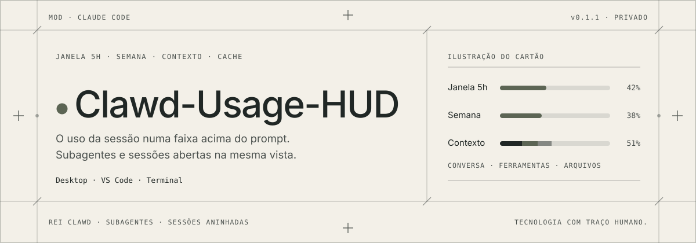
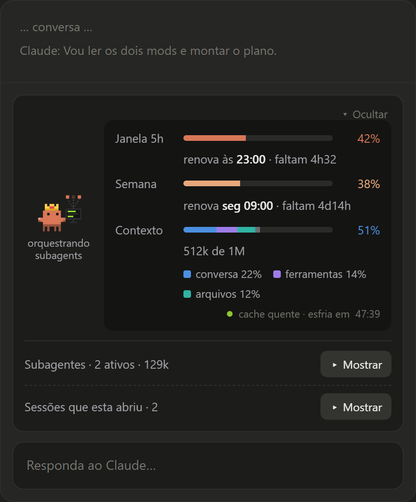
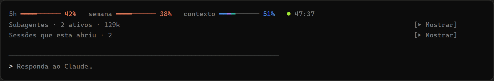
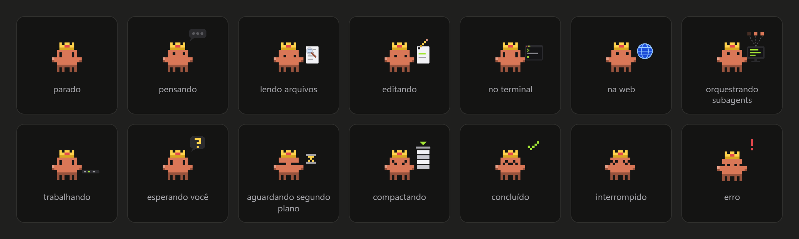

<picture>
  <source media="(prefers-color-scheme: dark)" srcset="assets/hero-grafite.svg">
  
</picture>

<h1 align="center">Clawd-Usage-HUD</h1>

<p align="center">Saiba quanto ainda resta da janela de 5 horas, da semana e do contexto do Claude Code sem sair da conversa, e veja o que a sessão está fazendo enquanto você espera.</p>

<p align="center">
  
  
  <a href="LICENSE"></a>
</p>

<p align="center">
  <a href="#começar-a-usar">Começar a usar</a> &nbsp; / &nbsp;
  <a href="#demonstração-e-recursos">Ver recursos</a> &nbsp; / &nbsp;
  <a href="#documentação-e-ajuda">Documentação</a>
</p>

---

## Sobre o projeto

Quem usa o Claude Code o dia inteiro costuma descobrir o limite tarde demais. A janela de 5 horas acaba no meio de uma tarefa, o contexto enche sem aviso e o cache esfria enquanto você foi buscar um café. O Clawd-Usage-HUD é um mod que coloca esses números numa faixa logo acima da caixa de mensagem, no app desktop, no VS Code e no terminal.

Ao lado das barras fica o Rei Clawd, um personagem em pixel art que muda de pose conforme o que a sessão está fazendo. Bate o olho e você já sabe se o Claude está lendo arquivos, rodando um comando, distribuindo trabalho para subagentes ou parado esperando a sua resposta.

A faixa começa recolhida numa linha em toda sessão nova, então só ocupa espaço quando você pede.

## Demonstração e recursos

### App desktop


<sub>Cenário "Trabalhando com subagentes" do protótipo da interface. Os valores são fictícios.</sub>

### VS Code

Na extensão do VS Code a faixa usa o mesmo desenho do app desktop, com as colunas empilhadas para caber no painel lateral.



### Terminal

No terminal não há desenho: as três barras, o cache e a contagem cabem numa linha só, com Subagentes e Sessões logo abaixo, cada um com seu botão de mostrar.



<sub>Capturas do protótipo da interface (<code>docs/prototipo/prototipo.html</code>), com valores fictícios.</sub>

### Os 14 estados do Rei Clawd

O Rei muda de pose a cada coisa que a sessão faz. Cada subagente ganha o seu próprio Clawd, sem coroa, com a mesma lógica.



| Estado | Quando aparece |
| --- | --- |
| Parado | A sessão não está fazendo nada. |
| Pensando | O Claude está montando a próxima resposta. |
| Lendo arquivos | Abriu ou buscou arquivos (Read, Grep, Glob). |
| Editando | Está escrevendo ou alterando arquivos. |
| No terminal | Rodou um comando no Bash ou no PowerShell. |
| Na web | Pesquisou ou abriu uma página. |
| Orquestrando subagentes | Mandou trabalho para subagentes ou workflows. |
| Trabalhando | Usou qualquer outra ferramenta. |
| Esperando você | Fez uma pergunta ou pediu a aprovação de um plano. |
| Aguardando segundo plano | A resposta terminou, mas ainda há subagentes rodando. |
| Compactando | O contexto está sendo resumido. |
| Concluído | A resposta acabou de ser entregue. |
| Interrompido | Você parou a resposta no meio. |
| Erro | A resposta falhou. |

Concluído, interrompido e erro ficam na tela por um instante e depois voltam para parado (ou aguardando, se ainda houver trabalho em segundo plano).

### O que você consegue fazer

- Ver quanto já gastou da janela de 5 horas e da semana, a que horas cada uma renova e quanto falta para isso.
- Entender o que está ocupando o contexto, separado em conversa, ferramentas e arquivos. A legenda aparece quando há trabalho em andamento ou o contexto está alto.
- Saber pela cor se o cache ainda vale: verde com contagem regressiva enquanto está quente, amarelo nos últimos 5 minutos e azul quando a próxima mensagem vai reler tudo do zero.
- Não perder o trabalho quando o cache está para esfriar. Se a sessão estiver parada e faltarem 5 minutos, o mod pede à própria sessão que registre as pendências conforme as regras da pasta, uma vez a cada período parado.
- Acompanhar os subagentes e as sessões que esta sessão abriu, com modelo, uso do contexto, tempo e ação atual de cada um, e parar qualquer um pelo botão Parar.
- Recolher o cartão, a lista de subagentes e a de sessões, cada um no seu botão.

As barras e os subagentes funcionam nas três superfícies. A lista de sessões abertas por esta depende do app desktop, que é onde uma sessão consegue abrir outra.

## Começar a usar

O mod é instalado como um marketplace local do Claude Code, a partir de uma cópia deste repositório. A mesma instalação vale para o app desktop, o VS Code e o terminal.

1. Clone o repositório numa pasta da sua máquina (o acesso é restrito).
2. Em `~/.claude/settings.json`, registre a pasta como marketplace e ligue o plugin:

```json
{
  "extraKnownMarketplaces": {
    "clawd-usage-hud": {
      "source": { "source": "directory", "path": "CAMINHO/DA/PASTA/clawd-usage-hud" }
    }
  },
  "enabledPlugins": {
    "clawd-usage-hud@clawd-usage-hud": true
  }
}
```

3. Abra uma sessão nova do Claude Code. A faixa aparece recolhida acima do prompt, e o botão Mostrar abre o cartão.

### Estrutura

| Pasta | Conteúdo |
| --- | --- |
| `.claude-plugin/` | Manifesto do plugin e do marketplace |
| `hooks/` | Registro do mod (`register.tsx`), desenho do Rei Clawd, cartão e leitura das sessões |
| `types/` | Contrato do estado que o cartão desenha |
| `tests/` | Testes do cartão, do cache e das sessões aninhadas |
| `docs/prototipo/` | Protótipo da interface e decisões de desenho |

## Documentação e ajuda

| Assunto | Onde consultar |
| --- | --- |
| Decisões de interface e comportamento | [docs/prototipo/DECISOES.md](docs/prototipo/DECISOES.md) |
| Protótipo navegável, com seletor de superfície, situação e pose | [docs/prototipo/prototipo.html](docs/prototipo/prototipo.html) |
| Formato do estado do mod | [types/index.d.ts](types/index.d.ts) |

### Créditos e materiais de terceiros

Claude e Claude Code são marcas da Anthropic. Este mod não é afiliado à Anthropic.

## Autoria e licença

Desenvolvido por [Alison Cruz](https://github.com/ba-lison) · **BALISON**.

Software proprietário da **BALISON**. Todos os direitos reservados; uso, cópia ou distribuição dependem de autorização prévia e por escrito. Veja o [arquivo LICENSE](LICENSE).

---

<p align="center">
  <a href="https://github.com/ba-lison">
    <picture>
      <source media="(prefers-color-scheme: dark)" srcset="assets/assinatura-grafite.svg">
      
    </picture>
  </a>
  <br>
  <sub>Tecnologia com traço humano.</sub>
</p>
